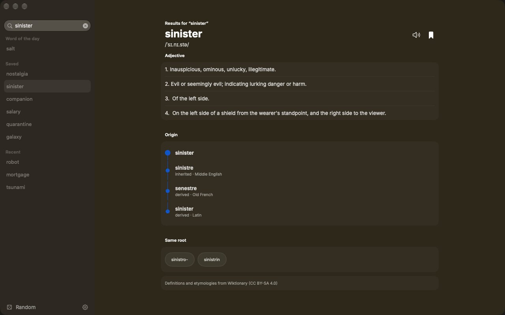
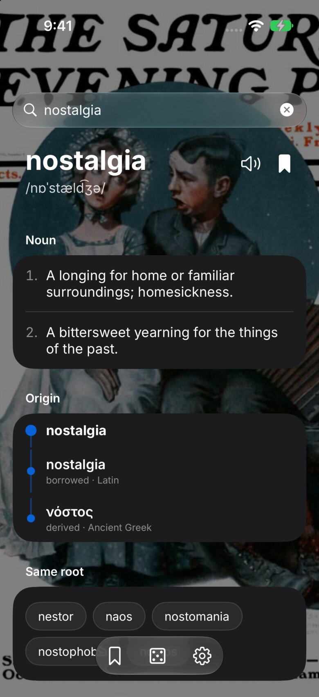
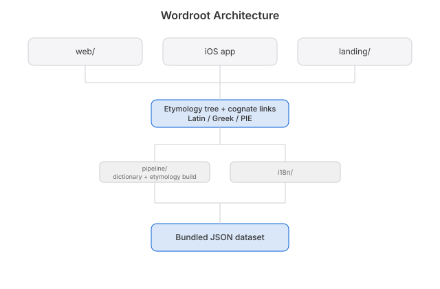

# Eponym


Where did that word come from? Look it up and follow it back, through Latin, Greek, all the way to Proto-Indo-European. A dictionary with the roots showing.

Formerly Wordroot. An eponym is a word named after a person, like sandwich or boycott: every one is a word-origin story, which is what this app tells.


## Screenshots

<p>


</p>

## How it works


Wiktionary (CC-BY-SA) is parsed into a graph of words and edges. WordNet fills gaps. No OED, no Etymonline, no etymology a model made up.

Twelve interface languages, thirty word languages. Etymology always comes from the English Wiktionary. Definitions come from your own language's Wiktionary first, then English.

- **pipeline/**: Python parser, stdlib only
- **ios/**: SwiftUI for iPhone and Mac
- **web/**: static site on the same data
- **i18n/**: one string catalog for every surface

## Run
```sh
python3 scripts/gen-i18n.py           # regenerate the i18n bundles after editing the catalog
python3 scripts/gen-i18n.py --check   # verify they are current

python3 pipeline/parse.py             # builds eponym.sqlite from English sample words
python3 pipeline/parse.py --lang de   # ...or German, added alongside
python3 pipeline/test_parse.py

node scripts/test-web.mjs             # web app + landing page: i18n and lookup
```

**Terminal:** `swift build && ./.build/debug/eponym-tui etymology`, see [tui/](tui/)

## License
MIT © 2026 Joshua Trommel

[Whitepaper](docs/WHITEPAPER.md) · [API and agent tools](docs/API.md) · [Brand kit](brand/BRAND.md) · [Architecture](docs/ARCHITECTURE.md)
